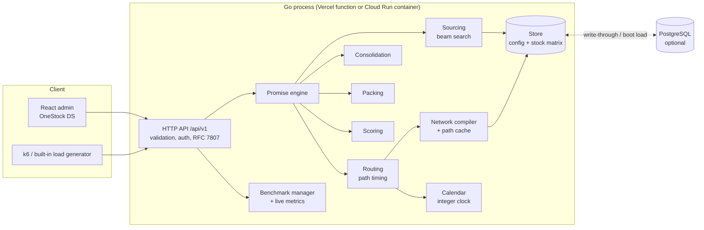
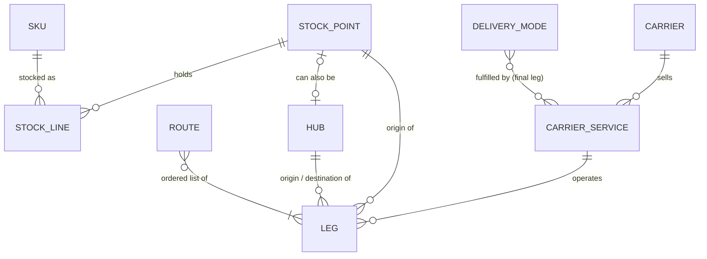

# Architecture

This document explains how the Delivery Promise & Multi-Leg Routing Engine is built, why, and what its limits are.

## 1. Requirements recap

| Need | Where it is handled |
|---|---|
| Configure carriers, services, stock points, hubs, legs, routes, delivery modes | `pkg/model`, `pkg/store`, CRUD in `pkg/api` |
| 120 stock points × 10,000 SKUs = 1.2M stock lines | `pkg/datagen`, dense matrix in `pkg/store/stock.go` |
| Multi-source sourcing, packaging, multi-leg multi-carrier routes, consolidation | `pkg/engine` |
| Calendars, cut-offs, French holidays, time zones | `pkg/calendar` |
| REST API, OpenAPI, validation, pagination, admin auth, RFC 7807 errors | `pkg/api`, `docs/openapi.yaml` |
| Web admin in the OneStock design system | `web/` |
| Load tests and history | `pkg/bench` (built-in), `bench/k6` (k6), `cmd/benchreport` |
| P95 < 100 ms (client side) on the reference scenario | see `docs/PERFORMANCE.md` |
| Run on Vercel first, then GCP | `api/index.go` + `vercel.json`; `Dockerfile` + `cloudbuild.yaml` |

## 2. Technical decisions

### Go rather than Rust

The brief preferred Rust/Axum, "or Go if the benchmarks justify it". The deciding constraint was the deployment order: **Vercel first**. Vercel runs Go functions natively (official runtime, `api/*.go`), while Rust needs a community runtime. Go also gives:

- a single static binary for Docker / Cloud Run (distroless image, about 15 MB);
- a standard library HTTP server and JSON encoder good enough for the latency target (measured, see the performance report);
- goroutines for the built-in load generator and parallel data generation.

The measured engine time is about 0.8 ms per request single-threaded on the reference dataset (`make bench-go`), so the language is not the bottleneck: the algorithmic design (bounded search, compact indexes) is.

### In-memory engine, optional PostgreSQL

Everything the promise engine reads lives in process memory: the compiled network and the stock matrix (≈ 10 MB for 1.2M lines). **There is no network call on the request path.** PostgreSQL is the system of record when `DATABASE_URL` is set:

- configuration entities are JSONB documents with generated key columns (`pkg/pg/migrations/001_init.sql`), so the model can gain optional fields without a migration for each;
- the catalog and the 1.2M stock lines are relational (`skus`, `stock_lines`), bulk loaded with `COPY` (seed about 30 s locally) and read back at boot (about 1.2 s);
- every admin write is written through synchronously; stock updates are upserted in batches.

Without `DATABASE_URL` (default on Vercel), the dataset is **generated at cold start** from the seed (deterministic, about 150 ms). Admin changes then live only in that instance's memory; this is the documented trade-off of the zero-dependency Vercel mode.

**Redis was not added.** The only caches are per-process and derived from the configuration version (compiled network, path sets per department and mode, column-to-node mapping). A shared cache would add a network hop to the critical path without removing any computation.

### Serverless and container from the same code

`pkg/app.Bootstrap` builds the server from environment variables. `cmd/server` wraps it in a long-running `http.Server` (local, Docker, Cloud Run, also serves `web/dist`); `api/index.go` wraps it in a Vercel handler (`vercel.json` rewrites `/api/*` to it and serves the SPA statically).

## 3. Components

| Package | Responsibility |
|---|---|
| `pkg/model` | Entities and API contracts (JSON tags are the contract). |
| `pkg/store` | Thread-safe repository with a config version; dense stock matrix, availability bitmaps, snapshots. |
| `pkg/calendar` | French holidays (Easter-based included), working days, opening hours, cut-offs, departures; integer clock with per-day DST table. |
| `pkg/network` | Compiles the graph, enumerates bounded paths per (department, mode), caches them, canonicalises identical paths. |
| `pkg/engine` | Candidate prefilter, beam-search allocation, packing, direct and consolidated plans, timing, scoring, response building. |
| `pkg/pricing` | Article rules, restrictions, rate card compilation and evaluation (cost, price, carbon, custom outputs). See `docs/PRICING.md`. |
| `pkg/geo` | Department centroids, distances. |
| `pkg/datagen` | Reproducible dataset. |
| `pkg/bench` | Live latency recorder, basket generator, built-in load generator. |
| `pkg/pg` | PostgreSQL persistence and migrations. |
| `pkg/api` | REST handlers, OpenAPI document. |

## 4. Data model

- **Stock point** (`STORE`, `WAREHOUSE`, `LAST_MILE_HUB`): address, coordinates, opening hours, preparation calendar, preparation time, cut-off, capacity, safety stock, allowed modes, handling cost.
- **Hub**: transit and/or consolidation node, with calendar, opening hours, sorting and consolidation times, maximum wait between components, cost, unavailability windows and an active flag. A last-mile hub is both a stock point and a hub (same id).
- **Carrier service**: kind, modes it fulfils as a final leg, coverage (departments, exclusions, optional postal codes), transit (business days for final legs, minutes for hub-bound legs), pickup and delivery calendars, cut-off, delivery window, weight / volume / item limits, costs.
- **Leg**: directed edge `from → to` (hub or `CUSTOMER`), carrier, service, scheduled departures, cut-off before departure, optional overrides (calendar, transit, zones, modes, max weight, extra cost).
- **Route**: explicit, named sequence of contiguous legs (always considered, even beyond the automatic search depth).
- **Delivery mode**: max legs, max sources, consolidation allowed, split of a SKU across sources allowed, max business days.

The promise response models the logistic objects explicitly and separately:

| Concept | Response field |
|---|---|
| Stock allocation | `allocations[]` (point, SKU, quantity) |
| Preparation group | `preparationGroups[]` (point, items, ready time, parcels prepared) |
| Physical parcel | `packages[]` (exact items, sources, weight, volume, full route, hubs) |
| Shipment | `shipments[]` (`DIRECT`, `INBOUND` to a hub, `OUTBOUND` after consolidation) |
| Route and legs | `shipments[].legs[]`, `packages[].route[]` with departure / arrival / carrier / service / cost |
| Consolidation | `consolidations[]` (hub, inbound shipments, last arrival, ready time, outbound parcels) |
| Promise | `estimatedDelivery {from, to}`, `timeline[]`, `criteria`, `score` |

A parcel is independent from a stock point: one point can produce several parcels (weight, volume or item limits), and a consolidated parcel can carry items from several points. `packagesBeforeConsolidation` and `totalPackages` give the parcel count before and after consolidation.

## 5. The promise algorithm

For each requested delivery mode:

1. **Validation and destination**. Postal code → department (`20` for Corsica, `97x`/`98x` overseas are reported as not served).
2. **Stock snapshot**. One read lock copies the promisable quantities (`physical - reserved - safetyStock`, listed lines only) of the basket SKUs for every point, plus their availability bitmaps. Cost: `k × 120` integers.
3. **Paths to the zone** (cached). The network compiler enumerates, for `(department, mode)`, every path ending with a final leg that serves the department and fulfils the mode: bounded reverse DFS from the final legs, at most `maxLegs` legs, transit nodes must be active hubs, no cycles; explicit routes are added. Identical leg sequences share one canonical path object across modes and departments. The result is cached in the compiled network, which is itself invalidated by the configuration version.
4. **Candidate prefilter**. The OR of the basket availability bitmaps gives the points holding at least one SKU; points without a path to the zone (directly or through a consolidation hub) are dropped. The rest are ranked by basket coverage, then by distance to the department centroid, and only the best `maxCandidates` (48) have their routes timed. This bounds the work whatever the basket.
5. **Preparation and route timing** of each retained point (memoised per request): preparation ready time from the order time (cut-off, preparation calendar, opening hours, preparation time spilling over days), then each leg (next scheduled departure on a working day of the carrier calendar respecting the cut-off before departure; arrival at the hub, reception postponed by unavailability windows and opening hours, sorting time; final leg delivered `transitDays` delivery-working days later within the service window).
6. **Sourcing by beam search**. All single-source full covers are enumerated (best `maxAllocations` by ETA). Multi-source allocations come from a beam search: each step adds the source taking the most remaining units, penalised by its delivery estimate and the number of sources (beam width 6, depth `maxSources`, split of a SKU across sources if the mode allows it). Allocations are deduplicated by hash and the best `maxAllocations` (12) are kept, always including a multi-source one if any exists.
7. **Plans per allocation**:
   - *direct (fastest)*: each source ships on its fastest feasible path;
   - *direct (cheapest)*: each source ships on its cheapest feasible path;
   - *consolidated*: for every consolidation hub serving the zone, each source ships to the hub (≤ 2 legs, or nothing if the hub is the source), consolidation starts when the **last** component has been received (plus consolidation time), is rejected if components arrive more than `maxConsolidationWaitHours` apart, then the goods are **repacked** and leave on the hub's best path. The best `maxHubsPerPlan` hubs are kept.
   Packing is first-fit decreasing by weight with the tightest limits of the path legs (and the request constraints); one unit above the limits makes the path infeasible. Packing results are memoised per limit set.
8. **Acceptance**: business days between order and delivery ≤ `maxDeliveryDays` of the mode, parcel count ≤ `constraints.maxPackages`.
9. **Scoring** within the mode: min-max normalisation of delivery time, parcel count, cost, legs and sources, `score = 1 - Σ wᵢ·normᵢ / Σ wᵢ` (weights from the settings or the request).
10. **Selection**: best option of each mode, then best option of each (mode, strategy), then by score; identical outcomes are not repeated. Only selected options are turned into the full response.

The engine never claims global optimality: it returns several good solutions found by bounded heuristics. The quality of these heuristics was measured against a near-exhaustive search (all candidates, beam 16, 40 allocations) on 500 generated baskets and 1,562 (basket, mode) pairs:

| Settings | Engine time / request | Same earliest promise as the near-exhaustive search | Later when different | Modes lost |
|---|---:|---:|---:|---:|
| candidates 32, beam 6, allocations 12 | 1.12 ms | 93.5 % | +25 h avg | 0 |
| **candidates 48, beam 6, allocations 12 (default)** | 1.20 ms | **94.6 %** | +26 h avg | 0 |
| candidates 48, beam 8, allocations 20 | 1.48 ms | 96.0 % | +26 h avg | 0 |
| candidates 48, beam 10, allocations 24 | 1.66 ms | 96.7 % | +26 h avg | 0 |
| candidates 48, beam 16, allocations 40 | 2.69 ms | 99.1 % | +35 h avg | 0 |

(`QUALITY=1 go test -run HeuristicQuality -v ./pkg/engine/`, times measured with `maxOptions = 50`.) The settings screen exposes these parameters.

### Complexity and what is avoided

| Avoided | How |
|---|---|
| Exhaustive allocation enumeration | Beam search, bounded depth and width; top-K allocations |
| Full stock scans | Per-SKU bitmaps over stock points; snapshot of the basket SKUs only |
| Joins per request | All data in memory, compiled once per configuration version |
| Unbounded path search | `maxLegs` (≤ 5), hubs only as transit, no cycles, cached per (department, mode) |
| Calendar recomputation | Integer clock (per-day DST and holiday tables for 2015-2045), memoised preparation and path timings per request, canonical paths shared across modes |

### Pricing in the search

Rate cards are compiled with the network (one output registry per configuration version). For each candidate path the engine checks the article restrictions of every leg (bitmask of basket items per leg, cached per request), packs the parcels, measures them once per limit set and evaluates the leg cards (PARCEL or SHIPMENT scope); a card with `noMatch: REJECT` can make a path infeasible. Per allocation it keeps the fastest, cheapest and lowest-carbon path of every shipment (plus custom criteria outputs), then adds order-level outputs (customer price cards with franco, requested additional services and their delays) and ranks plans with the delivery mode criteria. Stock views filter candidate points and articles before the beam search. Details: `docs/PRICING.md`.

## 6. Stock consistency and freshness

Four quantities are distinguished for every line:

- **physical**: units on hand;
- **reserved**: units already promised to orders;
- **available** = physical − reserved (available to sell);
- **promisable** = available − safety stock of the point (0 when the SKU is not listed): what the engine uses.

**Snapshot isolation per request.** The stock matrix is protected by a read/write lock. A promise takes the read lock only to copy the basket's quantities (microseconds), then computes on its private copy. A batch update (`PATCH /stock`, `POST /stock/import`) takes the write lock once, updates the quantities and the availability bitmaps incrementally (one bit per touched line, no index rebuild), and increments `stockVersion`. Each response returns the `stockVersion` it was computed on; the concurrent test (`TestConcurrentStockUpdates`) checks that no allocation exceeds the stock of its own snapshot version.

**A promise never reserves stock.** Two concurrent customers can both be promised the last unit. The order capture system must reserve at order time (and can call the engine again if the reservation fails). The promise is therefore an estimate that is fresh at its `stockVersion` only.

**Freshness**: an update is visible to the next request after the write lock is released (single process). With several instances (Cloud Run scale-out, Vercel concurrency), each instance has its own matrix: with PostgreSQL, instances only see other instances' stock updates after a restart or reseed. Production would add an update feed (Pub/Sub, LISTEN/NOTIFY or Kafka) applying the same incremental batches to every instance; the store API (`Stock.Apply`) is already shaped for that.

**Configuration changes** bump `configVersion`; the next request recompiles the network (a few milliseconds) and the path caches start empty.

## 7. Performance design

- Stock matrix SKU-major (`[sku][point]`): reading a basket touches `k` contiguous rows.
- Availability bitmaps: `⌈points/64⌉` words per SKU, OR of the basket rows in a few instructions.
- Integer time: all engine times are Unix seconds; local date and time-of-day come from a precomputed per-day table (midnight, DST transition, holiday), validated against the `time` package on 20,000 random cases including DST days.
- Allocation-light hot path: hash keys instead of string signatures, bounded insertion instead of sorting full candidate lists, dense node indexes instead of string maps, memoised packing.
- GC target raised to 200 % (heap ≈ 50 MB, mostly long-lived).
- No I/O on the request path; JSON encoding with `encoding/json`.

Profiling-driven improvements and their measured effect are listed in `docs/PERFORMANCE.md`.

## 8. Known limitations

- Single-process stock and caches: horizontal scaling needs an update feed (section 6). On Vercel without a database, admin changes are per instance and lost at the next cold start.
- Capacities (`dailyCapacity` of points and services) are stored and displayed but not consumed by the engine (no load-aware routing).
- Volumes are approximated per SKU (no 3D packing); parcels are packed by weight, volume and item count.
- Delivery windows come from the final service; there is no slot booking.
- Time zones: one zone per deployment (Europe/Paris by default); per-point time zones are stored but not used for mixed-zone networks.
- Costs are per parcel and per kg per leg plus handling and consolidation costs; no carrier rate cards by zone or weight band.
- Heuristic search: see the quality table in section 5.
- The built-in benchmark on Vercel is capped at 25 s per run and runs inside the function instance (it measures the instance, not Vercel's edge network).
